<picture>
  <source media="(prefers-color-scheme: dark)" srcset="assets/cosmos-dark.svg">
  
</picture>

<picture>
  <source media="(prefers-color-scheme: dark)" srcset="assets/stats-dark.svg">
  
</picture>
